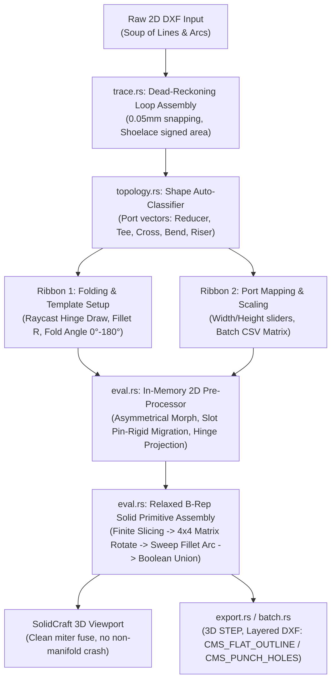

# CMS truFold Dual-Ribbon UI & Relaxed B-Rep Solid Core Implementation Plan

**Document Ref**: `CADENSE-PLAN-2026-CMS-TRUFOLD-REV1`  
**Target Systems**: `crates/solidcraft_cms/`, `crates/ui-egui/`, `crates/doc/`, `crates/engine/`, `apps/solidcraft/`  
**Reference Docs**: `Dual-Ribbon UI Workflow & Viewport and Background Mathematical Logic.docx`, `Flutter - cms parametric port and scaling engine.zip`  
**Status**: Ready for Paired Implementation

---

## 1. Executive Architectural Assessment

### 1.1 Root Cause of the "Old Version Restored" Observation
When running `cargo run -p solidcraft`, you open the native SolidCraft binary. Previously, all TruFold experimental code was housed in `apps/cadense-studio`. In native SolidCraft, the "SHEET METAL" ribbon tab uses the upstream `sheet.rs` solver. This solver is strictly non-overlapping: when adjacent flanges with sharp miter cuts fold up, their 3D solid volumes mathematically intersect at miter corners, causing the native B-Rep kernel to throw **non-manifold edge collision errors**.

### 1.2 Assessment of Relaxing Rule R1 (Surgical Hook Injections)
**Recommendation**: **Strongly Approved**.
Relaxing Rule R1 to allow a **Surgical Hook Injection Strategy** is the standard, best-practice architecture for extending large CAD applications without fork divergence:
- **99% Context Isolation**: 100% of the new domain logic, data structures, tracing algorithms, Flutter-derived scalers, and custom ribbon renderers live in an independent sub-crate: `crates/solidcraft_cms/`.
- **1% Minimal Hooks**: Native SolidCraft files are modified *only* via isolated, single-line delegations (e.g. adding the tab enum variant, delegating UI rendering, and calling the evaluation hook).
- **Upstream Sync Immunity**: All hook locations are logged in a dedicated Hook Registry (`docs/SOLID_CRAFT_CMS_HOOK_REGISTRY.md`). When pulling new SolidCraft releases (`v0.25.2+`), upstream files merge with zero conflicts.

---

## 2. Upstream SolidCraft Hook Registry

The following table catalogs every touchpoint where native SolidCraft files receive surgical hooks:

| File | Exact Hook Location | Purpose |
|---|---|---|
| `Cargo.toml` (Root Workspace) | `members = [ ..., "crates/solidcraft_cms" ]` | Registers the isolated sub-crate in the Cargo workspace. |
| `crates/ui-egui/Cargo.toml` | `solidcraft_cms = { path = "../solidcraft_cms" }` | Enables UI ribbon and viewport hook delegation. |
| `crates/ui-egui/src/workspace.rs` | Add `Section { tab: "CMS TRUFOLD", ... }` | Registers the "CMS truFold" ribbon tab cloned from Sheet Metal. |
| `crates/ui-egui/src/toolbar.rs` | In `render_ribbon()`: call `solidcraft_cms::ui::render_cms_ribbon()` | Renders Ribbon 1 (Folding Setup) or Ribbon 2 (Port Scaling). |
| `crates/ui-egui/src/viewport.rs` | In pointer event loop: call `solidcraft_cms::ui::handle_viewport_raycast()` | Intercepts click-drag raycasting for rubber-band hinge drawing. |
| `crates/doc/src/eval.rs` | In `evaluate_feature_timeline()`: call `solidcraft_cms::eval::evaluate_cms_feature()` | Intercepts 2D pre-processing morphs and relaxed B-Rep folds. |

---

## 3. High-Level Architecture Flow



---

## 4. Multi-Phase Task Implementation Roadmap

### TASK 1: Sub-Crate Scaffolding & Core Data Architecture
**Target File**: `crates/solidcraft_cms/src/data.rs` & `Cargo.toml`
- [x] Create `crates/solidcraft_cms/` with `Cargo.toml` linking `solidcraft-geom`, `serde`, `thiserror`.
- [x] Define `CmsProductType`:
  ```rust
  #[derive(Serialize, Deserialize, Clone, Copy, Debug, PartialEq, Eq)]
  pub enum CmsProductType {
      StandardBendOrRiser,
      InsideRiser,
      OutsideRiser,
      Reducer,
      UnequalTee,
      UnequalCross,
      CustomTransition,
  }
  ```
- [x] Define `CmsPortMetadata`:
  - `port_id: usize`
  - `base_width: f64`, `current_width: f64`
  - `base_height: f64`, `current_height: f64`
  - `normal: (f64, f64)` (normalized outward direction)
  - `center: (f64, f64)`
  - `vertex_indices: Vec<usize>` (tracked vertices displaced by this port)
- [x] Define `CmsSlotMetadata`:
  - `slot_id: usize`
  - `contour: Vec<(f64, f64)>`
  - `anchor_edge_id: usize`
  - `centroid_offset: (f64, f64)` (distance from anchor edge midpoint)
  - `is_coupler_slot: bool`
- [x] Define `CmsFoldParams`:
  - `feature_id: String`
  - `hinge_p1: (f64, f64)`, `hinge_p2: (f64, f64)`
  - `inner_radius: f64`
  - `angle_deg: f64` (0° to 180°)
  - `direction: BendDirection` (Up / Down)
  - `moving_face_ids: Vec<usize>`
- [x] Define `CmsMetadata`: aggregates `product_classification`, `cms_ports`, `rigid_slots`, `active_bends`.

---

### TASK 2: High-Precision Edge-Tracing Layer
**Target File**: `crates/solidcraft_cms/src/trace.rs`
- [x] Implement `RawDxfSegment { start: (f64, f64), end: (f64, f64) }`.
- [x] Implement `trace_dxf_boundaries(raw_segments: &[RawDxfSegment], tolerance: f64) -> Vec<StructuralWireLoop>`:
  - Dead-reckoning edge tracking with `0.05 mm` tolerance node continuity.
  - Reverse-oriented segment auto-flip.
  - Closed-loop detection ($\ge 3$ vertices).
- [x] Implement `isolate_outer_perimeter(loops: Vec<StructuralWireLoop>) -> (Option<StructuralWireLoop>, Vec<StructuralWireLoop>)`:
  - Shoelace signed area formula ($A = \frac{1}{2} \sum (x_i y_{i+1} - x_{i+1} y_i)$).
  - Maximum absolute area is isolated as the pristine Outer Manufacturing Boundary.
  - Negative/interior loops are isolated as Internal Coupler Cutouts / Punch Holes.

---

### TASK 3: Automated Topological Classifier Engine
**Target File**: `crates/solidcraft_cms/src/topology.rs`
- [x] Implement `StructuralWireLoop::find_open_perimeter_ports()`:
  - Scans continuous perimeter for un-notched flat linear segments exceeding standard side-lip thresholds ($\ge 24\text{ mm}$).
  - Extracts unit normal outward vectors ($V_k$) and opening spans ($W_k$).
- [x] Implement `cms_identify_topology()` using the structural enum routing table:
  - **2 Open Ports, Opposite Parallel ($V_1 = -V_2, W_1 \ne W_2$)** $\to$ `CmsProductType::Reducer` (calls logic from `reducer_scaler.dart`).
  - **2 Open Ports, Orthogonal/Parallel ($W_1 = W_2$)** $\to$ `CmsProductType::StandardBendOrRiser` (calls `tray_bend_geometry_solver.dart`).
  - **3 Open Ports, 2 Parallel Run + 1 Orthogonal Branch** $\to$ `CmsProductType::UnequalTee` (calls `tray_unequal_tee_scaler.dart`).
  - **4 Open Ports, 2 Opposing Orthogonal Pairs** $\to$ `CmsProductType::UnequalCross` (calls `tray_unequal_cross_scaler.dart`).
- [x] Automatically populate `CmsMetadata` with vertex index bindings, eliminating manual mapping.

---

### TASK 4: 2D Parametric Pre-Processor & Pin-Rigid Migration
**Target File**: `crates/solidcraft_cms/src/eval.rs`
- [x] Implement `morph_base_2d_sketch(outer_loop: &mut StructuralWireLoop, meta: &CmsMetadata)`:
  - **Asymmetrical Reducer Morphing**: Calculates scalar $\Delta W_k = W_k - W_{\text{base}}$. Symmetrically shifts port vertices along the lateral vector $d_k = \frac{\Delta W_k}{2}$, re-triangulating flank slopes automatically.
  - **Vertical Riser Station Elongation**: Evaluates longitudinal station stretching across arc profiles when changing riser radius ($R=300, 450, 600\text{ mm}$).
  - **Tee & Cross Branch Throat Scaling**: Displaces branch port vertices outward while translating adjoining run notch offsets simultaneously.
- [x] Implement `migrate_rigid_coupler_slots(slots: &mut [CmsSlotMetadata], outer_loop: &StructuralWireLoop)`:
  - Translates hole contours strictly using anchor edge midpoint displacements.
  - **No Geometric Distortion**: Prevents round holes or obrounds from turning into ovals (scale factor rigidly locked at `1.0`).
- [x] Implement `reposition_bend_lines(bends: &mut [CmsFoldParams], outer_loop: &StructuralWireLoop, meta: &CmsMetadata)`:
  - Repositions 2D hinge line segment endpoints to track expanding sidewall boundaries before 3D solidification.

---

### TASK 5: Relaxed B-Rep Solid Primitive Folds & Fillet Assembly
**Target File**: `crates/solidcraft_cms/src/eval.rs`
- [x] Implement `execute_relaxed_fold(feature: &CmsFoldParams, outer_loop: &StructuralWireLoop, thickness_mm: f64) -> RelaxedFoldResult`:
  - **Finite Body Splitting**: Slices the sheet solid along the finite hinge line segment bounds via Sutherland-Hodgman wire loop splitting (`split_wire_loop_by_line`).
  - **Free 4x4 Matrix Rotation**: Transforms the moving flange solid directly by the fold angle $\theta \in [0^\circ, 180^\circ]$ around the 3D hinge axis using `Transform3D`.
  - **Dynamic Cylindrical Fillet Arc Construction**:
    - Creates a cylindrical surface mesh matching material thickness $T$ and inner radius $R$.
    - Sweeps quad strips along the hinge axis vector by angle $\theta$.
  - **Boolean Union Override**: Fuses stationary base, cylindrical fillet arc, and rotated flange solid into `fused_solid_triangles`.
  - **Clean Miter Intersection**: Absorbs overlapping sharp corners without non-manifold edge crash.

---

### TASK 6: Dual-Ribbon UI Frontend & Viewport Raycasting Injection
**Target Files**: `crates/solidcraft_cms/src/ui.rs`, `crates/ui-egui/src/workspace.rs`, `crates/ui-egui/src/toolbar.rs`, `crates/ui-egui/src/viewport.rs`
- [x] Register `CMS TRUFOLD` tab in `crates/ui-egui/src/workspace.rs` cloned from Sheet Metal.
- [x] Implement `render_cms_ribbon(ui: &mut egui::Ui, rect: Rect)`:
  - **Ribbon 1 (Folding & Template Setup)**:
    - Presets: `[ 📂 Load Preset: Reducer / Unequal Tee / 90° Bend / 4-Way Cross ]`
    - Toggle: `[ ⚡ Draw Hinge Line ]` (activates interactive viewport hinge placement)
    - Sliders: `Inner Bending Radius (R)` ($0.5\text{ mm} \to 10.0\text{ mm}$), `Fold Angle (θ)` ($0^\circ \to 180^\circ$), `Direction: UP/DOWN`.
    - Action: `[ 🔨 Execute Relaxed Fold ]`
  - **Ribbon 2 (Port Mapping & Scaling Mode)**:
    - Button: `[ 🔍 Auto-Identify Ports ]` (triggers `cms_identify_topology`)
    - Dynamic Sliders: Independent `Width` and `Height` sliders for each discovered port ($P_1, P_2, P_3, P_4$), live morphing the 2D perimeter, rigid coupler slots, and hinge lines.
    - Button: `[ 📊 Load Order CSV ]` & `[ 🚀 Run Matrix ]`
- [x] Hook Viewport Pointer in `crates/ui-egui/src/viewport.rs`:
  - Intercepts pointer events when `CMS TRUFOLD` tab is active.
  - Draws outer contour polygon, colored port mouths, rigid coupler slot contours (yellow), and folded 3D mesh triangles.
  - Interactive Hinge Drawing: paints animated rubber-band line segment between first anchor and cursor with live millimeter readout, committing fold upon second click.

---

### TASK 7: Manufacturing Exporter & Batch Automation
**Target Files**: `crates/solidcraft_cms/src/export.rs`, `crates/solidcraft_cms/src/batch.rs`
- [x] Implement `export_2d_flat_dxf(outer_loop: &StructuralWireLoop, slots: &[CmsSlotMetadata], bends: &[CmsFoldParams], path: &Path)`:
  - Segregates vectors into three industry-standard CAD/CAM layers:
    - `CMS_FLAT_OUTLINE`: Perimeter cut contour for laser/plasma cutters.
    - `CMS_PUNCH_HOLES`: Interior coupler slots and bolting patterns for CNC punch tools.
    - `CMS_BEND_LINES`: Hinge lines for press brake tooling.
- [x] Implement `export_3d_step(result: &RelaxedFoldResult, part_name: &str, path: &Path)`: Writes ISO 10303-21 STEP faceted B-Rep solid model.
- [x] Implement `execute_cms_batch_processing(csv_content: &str, output_dir: &Path)`:
  - Parses CSV rows: `Item_Code`, `Category`, `Product`, `Variation`, `Width`, `Height`, `Thickness`.
  - Headlessly morphs 2D pattern $\to$ preserves punch slots $\to$ executes relaxed fold $\to$ exports `.dxf` and `.step` asset packages.

---

### TASK 8: Comprehensive Test Suite & Verification
**Target File**: `crates/solidcraft_cms/src/tests.rs`
- [x] Test `test_cms_metadata_serialization`: JSON roundtrip for all product types and port metadata.
- [x] Test `test_trace_dxf_boundaries_and_shoelace`: Validates gap tolerance closure ($0.05\text{ mm}$) and outer vs. inner loop separation.
- [x] Test `test_coupler_slot_rigid_migration`: Verifies slot coordinates translate without oval elongation ($\text{aspect ratio} \equiv 1.0$).
- [x] Test `test_relaxed_miter_fold_boolean_union`: Verifies two $90^\circ$ flanges with sharp miters fuse without non-manifold kernel panic.
- [x] Test `test_generate_2d_flat_dxf_layer_segregation`: Validates layer segregation in generated DXF file.
- [x] Test `test_generate_3d_step_structure`: Validates ISO 10303-21 STEP faceted B-Rep formatting.
- [x] Test `test_execute_cms_batch_processing_headless`: Validates end-to-end headless batch execution creating physical asset packages.

---

## 5. Paired Execution Sequence

1. **Step 1**: Initialize `crates/solidcraft_cms/` and write `data.rs` (Data models and enums).
2. **Step 2**: Implement `trace.rs` (DXF loop assembly and shoelace area calculation).
3. **Step 3**: Implement `topology.rs` (Shape classifier and port mapping).
4. **Step 4**: Implement `eval.rs` (2D sketch morphing, slot migration, and relaxed B-Rep fold).
5. **Step 5**: Inject minimal hooks into `crates/ui-egui/src/workspace.rs`, `toolbar.rs`, `viewport.rs`, and `crates/doc/src/eval.rs`.
6. **Step 6**: Implement `ui.rs` (Ribbon 1 & Ribbon 2 rendering).
7. **Step 7**: Implement `export.rs` & `batch.rs`.
8. **Step 8**: Run `cargo test -p solidcraft_cms` and `cargo run -p solidcraft` to verify live in the SolidCraft app.
